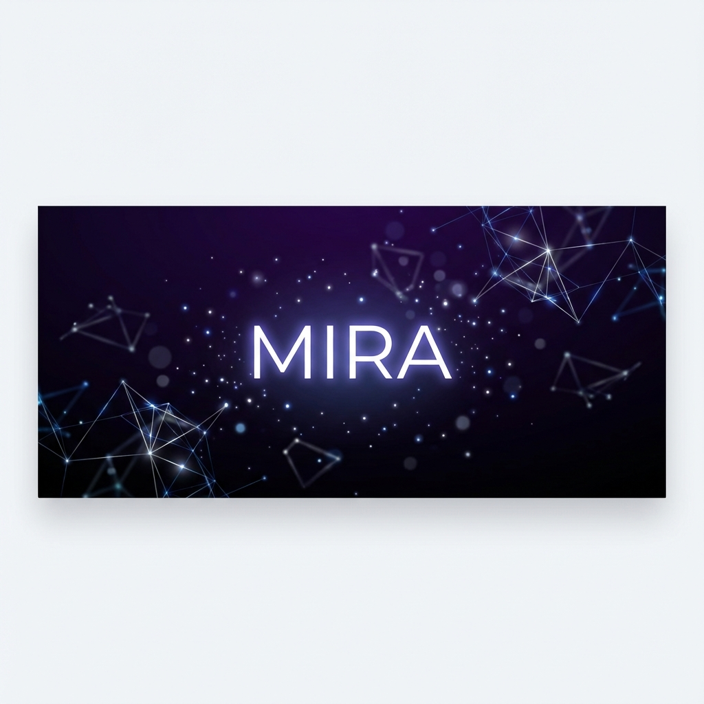
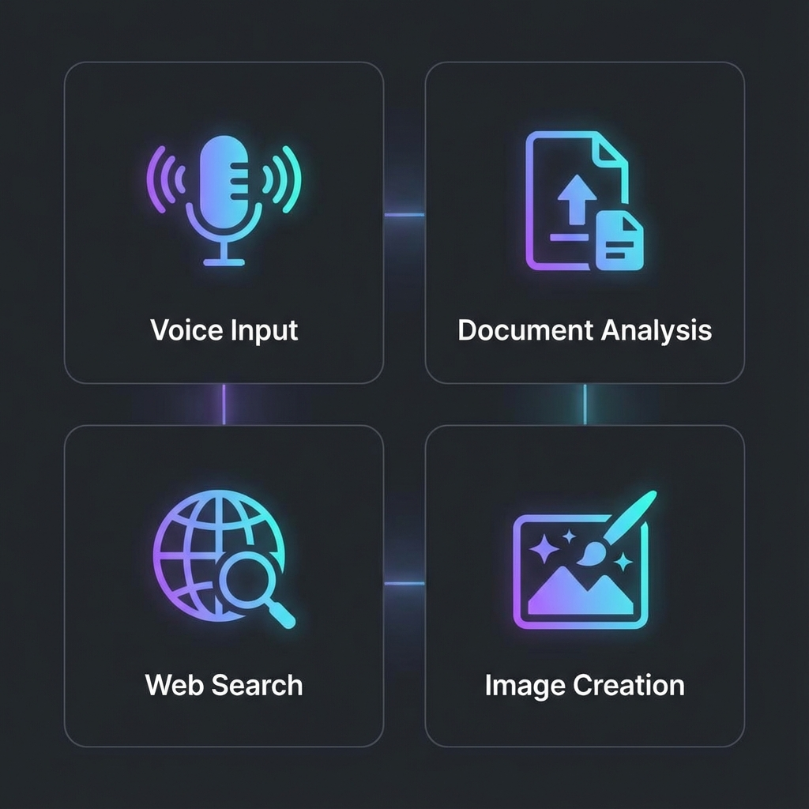
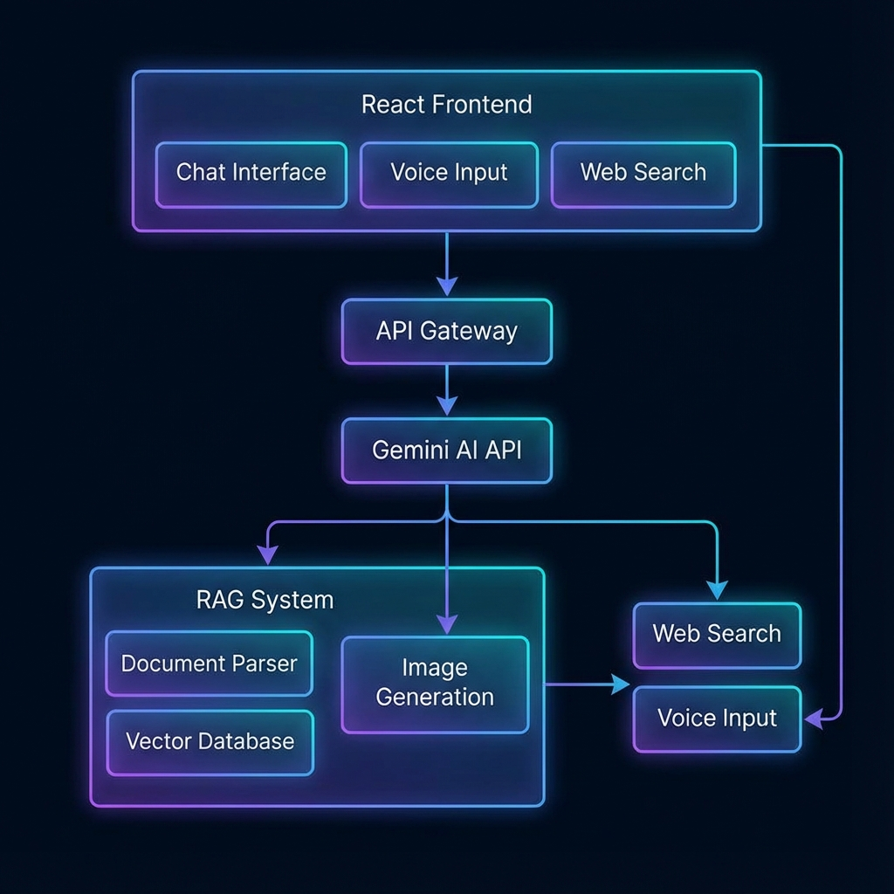

<div align="center">



# MIRA - Intelligent Sinhala AI Assistant 🤖

[](https://react.dev/)
[](https://www.typescriptlang.org/)
[](https://vitejs.dev/)
[](https://tailwindcss.com/)
[](https://ai.google.dev/)

**A modern, feature-rich AI chatbot with native Sinhala language support, built with React and powered by Google's Gemini AI.**

[Features](#-features) • [Quick Start](#-quick-start) • [Documentation](#-documentation) • [Architecture](#-architecture) • [Contributing](#-contributing)

</div>

---

## ✨ Overview

**Mira** (මීරා) is a sophisticated AI chatbot specifically designed for Sinhala speakers. It seamlessly handles both Sinhala script and Singlish (romanized Sinhala), providing intelligent responses powered by Google's Gemini AI models. The application features a stunning dark-themed UI with smooth animations and a comprehensive set of productivity features.


## 🎯 Features



### 🗣️ **Native Sinhala Language Support**


- **Singlish to Sinhala Conversion**: Automatically converts romanized Sinhala to native script
- **Grammar Enhancement**: Built-in grammar correction and text enhancement
- **Cultural Awareness**: Responses include proper Sri Lankan greetings and courteous language

### 🧠 **AI-Powered Capabilities**

| Feature | Description |
|---------|-------------|
| **Multi-Model Support** | Switch between Gemini 2.0 Flash, Gemini 1.5 Pro, and experimental models |
| **Streaming Responses** | Real-time token-by-token response streaming |
| **Context Memory** | Remembers user preferences and previous conversations |
| **RAG System** | Retrieval-Augmented Generation for accurate document-based answers |

### 📁 **Document Intelligence**

- **PDF Parsing**: Extract and analyze PDF documents
- **DOCX Support**: Process Microsoft Word documents
- **Text Files**: Support for TXT and Markdown files
- **Embeddings**: Semantic search across uploaded documents

### 🔍 **Web Search Integration**

- Real-time web search for current information
- Search results displayed alongside AI responses
- Source citations for transparency

### 🎨 **Image Generation**

- Create images using `/imagine` command
- Describe what you want, and Mira generates it
- Download and share generated images

### 🎤 **Voice Input**

- Native speech recognition support
- Optimized for Sinhala language (si-LK)
- Hands-free chatting experience

### 🎨 **Premium UI/UX**

- Beautiful dark theme with glassmorphism effects
- Smooth Framer Motion animations
- Responsive design for all screen sizes
- Command palette (`Ctrl+K`) for quick actions
- Slash commands for power users

---

## 🚀 Quick Start

### Prerequisites

- **Node.js** 18.0 or higher
- **npm** or **yarn** package manager
- **Google Gemini API Key** ([Get one here](https://aistudio.google.com/))

### Installation

```bash
# Clone the repository
git clone https://github.com/Hesara2003/Mira-chatbot.git
cd Mira-chatbot

# Install dependencies
npm install

# Configure environment variables
cp .env.example .env
# Edit .env and add your VITE_GEMINI_API_KEY
```

### Environment Setup

Create a `.env` file in the project root:

```env
VITE_GEMINI_API_KEY=your_gemini_api_key_here

# Optional: For enhanced web search (recommended for production)
VITE_BRAVE_API_KEY=your_brave_api_key_here
VITE_SERPER_API_KEY=your_serper_api_key_here
```

**Note**: Without web search API keys, the app will use free providers, but results may be less current. See [Web Search Guide](docs/WEB_SEARCH_GUIDE.md) for details.

### Running the Application

```bash
# Start the local API backend (terminal 1)
npm run dev:api

# Start the Vite frontend (terminal 2)
npm run dev

# Build for production
npm run build

# Preview production build
npm run preview
```

Keep both processes running. The frontend will be available at `http://localhost:5173` once the API proxy (`http://127.0.0.1:8000`) is up.

---

## 📖 Documentation

### Complete Guides

- **[Web Search Configuration Guide](docs/WEB_SEARCH_GUIDE.md)** - Setup and optimize web search for real-time information
- **[Web Scraping Documentation](docs/WEB_SCRAPING.md)** - Understanding the web scraping module

### Slash Commands

Mira supports a variety of slash commands for quick actions:

| Command | Description |
|---------|-------------|
| `/clear` | Clear current chat history |
| `/new` | Start a new chat session |
| `/search` | Open message search |
| `/upload` | Upload a file |
| `/web` | Toggle web search |
| `/model` | Cycle through AI models |
| `/imagine <prompt>` | Generate an image |
| `/code` | Get coding assistance |
| `/summarize` | Summarize the conversation |
| `/template` | Open templates panel |
| `/help` | Show available commands |

### Keyboard Shortcuts

| Shortcut | Action |
|----------|--------|
| `Ctrl + K` | Open command palette |
| `Ctrl + N` | New chat |
| `Ctrl + /` | Focus chat input |
| `Enter` | Send message |
| `Shift + Enter` | New line in message |

### Response Styles

Toggle between response styles for different needs:

- **Concise**: Brief, to-the-point answers
- **Detailed**: Comprehensive explanations

---

## 🏗️ Architecture



### Tech Stack

```
Frontend
├── React 19.2          # UI Framework
├── TypeScript 5.9      # Type Safety
├── Vite 7.2            # Build Tool
├── TailwindCSS 4.1     # Styling
├── Framer Motion       # Animations
└── Radix UI            # Accessible Components

AI & Processing
├── Google Gemini AI    # LLM Backend
├── RAG System          # Document Retrieval
├── Embeddings          # Semantic Search
├── PDF.js              # PDF Parsing
└── Mammoth             # DOCX Parsing

Features
├── Web Search          # Real-time Information
├── Image Generation    # AI Image Creation
├── Voice Input         # Speech Recognition
└── Singlish Converter  # Language Processing
```

### Project Structure

```
src/
├── components/           # React components
│   ├── ui/              # UI components (Canvas, Navbar, Panels, etc.)
│   ├── ChatInput.tsx    # Message input component
│   ├── MessageBubble.tsx # Chat message display
│   └── LandingPage.tsx  # Landing page
│
├── lib/                 # Core libraries
│   ├── api.ts           # Gemini API integration
│   ├── singlish.ts      # Singlish to Sinhala converter
│   ├── rag.ts           # RAG implementation
│   ├── embeddings.ts    # Text embeddings
│   ├── documentParser.ts # PDF/DOCX parsing
│   ├── webSearch.ts     # Web search integration
│   ├── imageGeneration.ts # Image generation
│   ├── chatStorage.ts   # Chat persistence
│   ├── userMemory.ts    # User preferences
│   └── cache.ts         # Response caching
│
├── contexts/            # React contexts
├── hooks/               # Custom React hooks
└── App.tsx              # Main application
```

---

## 🔧 Configuration

### Available Models

Mira supports multiple Gemini AI models:

| Model | Category | Best For |
|-------|----------|----------|
| `gemini-2.0-flash` | Balanced | General purpose, fast responses |
| `gemini-2.0-flash-exp` | Experimental | Latest features |
| `gemini-1.5-pro` | Quality | Complex reasoning tasks |
| `gemini-1.5-flash` | Fast | Quick interactions |
| `learnlm-2.0-flash-experimental` | Learning | Educational content |

### Customization

The application can be customized through:

- **Theme**: Dark theme with customizable accent colors
- **Language**: Primary support for Sinhala and English
- **Response Style**: Toggle between concise and detailed responses
- **Model Selection**: Choose your preferred AI model

---

## 🤝 Contributing

We welcome contributions! Please follow these steps:

1. **Fork** the repository
2. **Create** a feature branch (`git checkout -b feature/amazing-feature`)
3. **Commit** your changes (`git commit -m 'Add amazing feature'`)
4. **Push** to the branch (`git push origin feature/amazing-feature`)
5. **Open** a Pull Request

### Development Guidelines

- Follow TypeScript best practices
- Write descriptive commit messages
- Add tests for new features
- Update documentation as needed

---

## 📜 License

This project is licensed under the MIT License - see the [LICENSE](LICENSE) file for details.

---

## 🙏 Acknowledgments

- **Google Gemini** for the powerful AI capabilities
- **Radix UI** for accessible component primitives
- **Framer Motion** for smooth animations
- **TailwindCSS** for utility-first styling
- The open-source community for inspiration and tools

---

<div align="center">

**Built with ❤️ for the Sri Lankan community**

[⬆ Back to Top](#mira---intelligent-sinhala-ai-assistant-)

</div>
